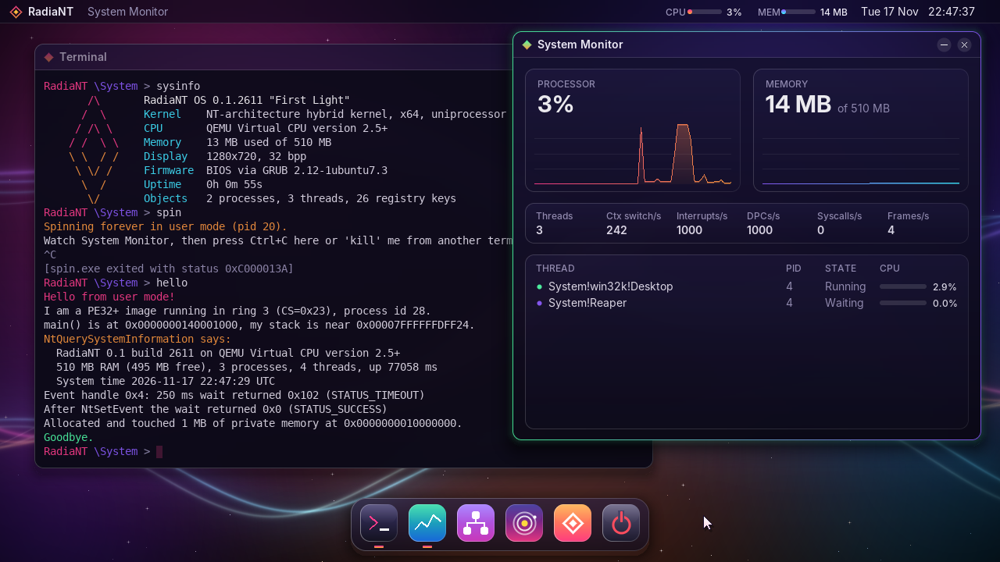

<p align="center">
  
</p>

<h1 align="center">RadiaNT OS</h1>
<p align="center"><b>A 64-bit operating system built from scratch on the NT kernel architecture.</b><br>
Hybrid kernel · HAL · IRQLs and DPCs · object manager · PE32+ user mode · software-composited glass desktop</p>

<p align="center">
  <a href="https://desyncccc.github.io/claude_os/"><b>Website</b></a> ·
  <a href="docs/download/radiant-x64.iso"><b>Download the ISO (5 MB)</b></a> ·
  <a href="#build">Build</a> ·
  <a href="#how-it-is-put-together">Architecture</a>
</p>

---

## What this is

RadiaNT is a hobby operating system for x86-64 PCs. Its kernel is **not Windows
and contains no Windows code** — every line is original — but it is organised
the way the Windows NT kernel is:

- a **HAL** underneath a small **kernel** (`Ke`) that owns interrupts, IRQLs,
  DPCs, dispatcher objects and the scheduler;
- an **executive** of managers on top: objects (`Ob`), processes and threads
  (`Ps`), memory (`Mm`), I/O (`Io`) and configuration (`Cm`, the registry);
- a kernel-mode window manager and graphics engine (`win32k`);
- user programs that are **PE32+ executables** running in ring 3 and entering
  the kernel with `SYSCALL` through a system service table, using the same
  register protocol NT uses on x64 (`RAX` = service, `R10/RDX/R8/R9` = arguments).

It will not run Windows applications or drivers and it is not affiliated with
Microsoft. It is a small, readable system — about 7,000 lines of C and
assembly — for seeing how an NT-style kernel fits together.

## Run it

Download [`radiant-x64.iso`](docs/download/radiant-x64.iso) and boot it in a VM:

```bash
qemu-system-x86_64 -m 512 -cdrom radiant-x64.iso
```

The ISO is a hybrid BIOS + UEFI image. Nothing is installed and no disk is
touched (there is no disk driver). The [website](https://desyncccc.github.io/claude_os/)
has instructions for VirtualBox, VMware and USB sticks.

Things to try in the Terminal:

| Command | What it shows |
| --- | --- |
| `sysinfo`, `ps`, `mem`, `pool` | Kernel state: threads, memory, pool tags |
| `obj \`, `types`, `drivers`, `irq` | The object namespace, drivers, devices, interrupts |
| `reg`, `syscalls`, `dmesg` | The registry, the service table, the boot log |
| `hello`, `primes`, `clock` | PE32+ programs running in ring 3 |
| `crash` | A process killed with `0xC0000005` for writing to kernel memory |
| `spin` | An infinite loop in user mode — the desktop stays responsive (Ctrl+C stops it) |
| `bugcheck` | A deliberate kernel `STOP` |

The dock also opens **System Monitor**, **Object Explorer** (a view of the
object manager namespace) and **Nebula** (a fixed-point plasma renderer).
Windows drag by their title bars; Alt+Tab switches, Alt+F4 closes.

## How it is put together

```
 ring 3   hello.exe  primes.exe  clock.exe  crash.exe  spin.exe      (PE32+)
 ─────────────────────── SYSCALL · system service table ───────────────────────
 ring 0   Ob        Ps        Mm        Io        Cm        win32k   (executive)
          Ke   scheduler · IRQL · DPCs · dispatcher objects · traps  (kernel)
          HAL  PIC · PIT · RTC · serial · CPUID · power
```

| Directory | Component | Highlights |
| --- | --- | --- |
| `kernel/boot` | Boot stub | Multiboot2 entry, builds page tables, enters long mode, jumps to the higher half |
| `kernel/hal` | HAL | 8259 PIC, 8254 PIT at 1 kHz, CMOS RTC, 16550 debug port, reset/power-off |
| `kernel/ke` | Kernel | GDT/IDT/TSS, IRQL, DPC queue, events/semaphores/mutants with timed waits, 32-level preemptive scheduler, `SYSCALL` entry, bugchecks |
| `kernel/mm` | Memory manager | PFN bitmap, physical map at `0xFFFF8000'00000000`, per-process PML4s with NX, tagged coalescing pool |
| `kernel/ob` | Object manager | Typed, reference-counted objects, `\` namespace with directories and symbolic links, handle tables |
| `kernel/ps` | Process manager | `EPROCESS`/`ETHREAD`, system threads, PE32+ loader, user processes, reaper thread |
| `kernel/io` | I/O manager | Driver and device objects, IRPs; `Null`, `Serial`, `Video` and `i8042prt` drivers |
| `kernel/cm` | Configuration manager | In-memory registry populated at boot |
| `kernel/ex` | Executive support | Event/mutant/semaphore object types, the 14 native system services |
| `kernel/win32k` | Window manager | Software rasteriser (AA shapes, shadows, glyphs), damage-tracked compositor, shell and apps |
| `kernel/rtl` | Runtime library | `memcpy` and friends, `printf`, fixed-point math |
| `user` | User mode | `ntdll.h` syscall stubs, a tiny CRT and the demo programs |

A few design notes:

- **IRQL discipline.** ISRs only move bytes and queue a DPC. DPCs run at
  `DISPATCH_LEVEL` when the IRQL is about to drop below it; the scheduler
  database is only touched at `DISPATCH_LEVEL`, so on one processor it needs
  no further locking.
- **Everything is an object.** Processes, threads, events, devices, drivers and
  even object types are `OBJECT_HEADER`-prefixed pool allocations. User mode
  refers to them through per-process handle tables (handles are multiples of 4).
- **Input is I/O.** The window manager reads the keyboard and mouse by sending
  `IRP_MJ_READ` to `\Device\KeyboardClass0` and `\Device\PointerClass0`.
- **No floating point.** The kernel is built with `-mgeneral-regs-only`; all
  graphics (anti-aliasing, blur, the plasma, the wallpaper) is fixed point.

## Build

On Ubuntu/Debian:

```bash
sudo apt install build-essential nasm clang lld xorriso mtools \
                 grub-pc-bin grub-efi-amd64-bin grub-common qemu-system-x86
```

```bash
make
```

```bash
make run
```

| Target | |
| --- | --- |
| `make` | Kernel, PE user programs and `build/radiant-x64.iso` |
| `make run` / `make run-uefi` | Boot in QEMU with SeaBIOS / OVMF |
| `make test` | Headless boot; passes when the desktop thread reports ready |
| `make site` | Copy the ISO and its checksum into `docs/download` for the website |
| `make FB_WIDTH=1920 FB_HEIGHT=1080` | Request a different video mode (default 1280×720) |
| `make fonts` | Re-rasterise the glyph atlases (needs Pillow, Inter and DejaVu) |

The kernel is compiled with GCC as an ELF64 image and loaded by GRUB via
Multiboot2. User programs are compiled with clang for `x86_64-pc-windows-msvc`
and linked with `lld-link` into native-subsystem PE32+ images, which GRUB hands
to the kernel as boot modules.

The kernel debug log goes to COM1; `make run` shows it in your terminal.

## Website

The site in [`docs/`](docs/) is static and is published with GitHub Pages:
**Settings → Pages → Build and deployment → Deploy from a branch**. Either
folder works: with `/docs` the site is served at the top of the Pages URL; with
`/ (root)` the top-level `index.html` forwards visitors to `docs/`. The ISO is
served from `docs/download/`; run `make site` after changing the kernel to
refresh it.

## Limits

RadiaNT is a demonstration, not a daily driver:

- one processor (no SMP, APIC or ACPI tables);
- no disk, file system, network, USB or sound — everything lives in RAM;
- PS/2 keyboard and mouse only;
- 14 system services: enough for the demo programs, not for a C library;
- PE is used as the executable container only — there is no Win32 API and no DLLs;
- tested in QEMU 8.2 under SeaBIOS and OVMF; other hypervisors and real
  hardware are unverified.

## Licence

MIT — see [LICENSE](LICENSE). Third-party notices (fonts, GRUB) are in
[NOTICE](NOTICE). “Windows” and “Windows NT” are trademarks of Microsoft
Corporation, used here only to describe the architecture this kernel is
modelled on.
